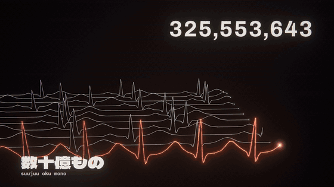

# Hacking to the Gate music video

**Watch it on YouTube:**

Fable's version (published): https://youtu.be/Gg3ZSuc6Ge8



Opus's version: https://youtu.be/-vxOWrPIgE4


Astra's version: https://youtu.be/kTyHvRSByX4


The video was made with Fable 5.1.
The concept and design were iterated a few times in conversation with Opus 5.5 and Fable 5.1.

## Requirements

[bun](https://bun.sh), Google Chrome (the offline renderer drives it headless through playwright-core), ffmpeg and ffprobe with libx264, and Python with [fontTools](https://github.com/fonttools/fonttools) for the fonts. The analysis tools need [uv](https://docs.astral.sh/uv/) and a CUDA GPU; the renderer doesn't.

## Setup

```sh
uv run --with fonttools python app/public/fonts/fetch.py   # the fonts, from google/fonts at a pinned commit, checked by hash
cd analysis && uv sync && uv run python build_full.py      # audio/song.wav from the album tracks (see docs/PIPELINE.md)
cd ../app && bun install
```

## Preview

```sh
cd app
bun x vite
```

## Render the video

```sh
cd app
bun scripts/render.ts thumbs       # stills of the whole video, for the opening's glimpses and the outro's rewind
bash scripts/render-parallel.sh    # the full video: out/hacking-to-the-gate.mp4 and a lighter -preview.mp4
```

### 4K

```sh
cd app
SCALE=2 CRF=18 bash scripts/render-parallel.sh 4 36 ../out/final-4k hacking-to-the-gate-4k
```

## Regenerate the timing data

The committed `data/*.json` files are all the renderer needs. Regenerating them needs the stems and intermediates, which are not in the repo; the pipeline is described in [`docs/PIPELINE.md`](docs/PIPELINE.md).

```sh
cd analysis
uv run python stems.py          # Demucs htdemucs_ft stems
uv run python analyze.py        # data/audio.json
uv run python align.py          # data/lyrics.json (the readings are in readings.py)
.venv/Scripts/python.exe lyric_breaks.py   # romaji word breaks (needs fugashi and unidic-lite)
```

The models download a few GB of weights into `analysis/.cache/`; delete that folder afterwards.

## Credits

- **Song:** "Hacking to the Gate", words and music by Chiyomaru Shikura, arranged by Toshimichi Isoe, sung by Kanako Itō; the opening theme of *Steins;Gate* (5pb./Nitroplus). The episode titles are the show's; the dates and world-line readings follow the Steins;Gate wiki's chronology.
- **Engine:** forked from [mexicat/pdoom-video](https://github.com/mexicat/pdoom-video) (MIT, [`LICENSE-pdoom-video`](LICENSE-pdoom-video)). The divergence meter's tubes are after [hkchengrex/divergent-meter-renderer](https://github.com/hkchengrex/divergent-meter-renderer).
- **Fonts:** Archivo, Cormorant Garamond, Dela Gothic One, DotGothic16, IBM Plex Mono, M PLUS 1 and Shippori Mincho (SIL Open Font License, fetched from google/fonts). Single-stroke EMS and Hershey fonts from Evil Mad Scientist Laboratories' Hershey Text (OFL / public domain).

## License

The code and the documents are released under the [MIT License](LICENSE). The fonts keep their own licenses (see Credits), and the song and lyrics (`audio/`, `lyrics/`, `data/lyrics.json`, the readings in `analysis/readings.py`) are not covered by it.
